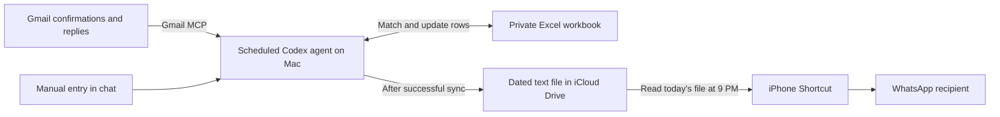

# How I designed the job tracker

I designed the tracker to identify daily changes in application status and summarize them for a designated recipient. An application can generate several emails, and some jobs I enter by hand. That led to the first design decision: **one Excel row represents one application**. A confirmation creates or matches a row. A later interview invitation, offer, or rejection updates that same row.

## How an update moves through the system

**Why Gmail?** It brings together employer replies and confirmations from multiple job sites, including SEEK. A manual entry covers a missing receipt. Using Gmail also means the workflow can follow an application from submission to decision even when the employer replies outside the job site.

**Why Excel and a dated file?** Excel gives me a place to filter rejections, correct a status, or enter a job myself. The draft has a different audience. The phone needs only the message I want to share. A file named `yyyy-MM-dd.txt` gives the Shortcut an exact input and keeps recruiter emails and workbook links out of WhatsApp.

## Agent and tool choices

| Component | What I used it for |
| --- | --- |
| Codex agent in a local chat | Runs the import, matches messages to roles, edits the workbook and writes the summary. One agent handles the reasoning across those steps. |
| Gmail MCP connector | Searches for candidate emails with `search_emails` and reads relevant bodies with `batch_read_email`. Reading the body matters when a subject like “Application update” could mean several things. |
| Codex app MCP | `automation_update` created and updated the daily schedule. During setup, `load_workspace_dependencies` located the spreadsheet runtime on the Mac. |
| Spreadsheet skill and local file tools | The initial workbook was built with `@oai/artifact-tool`. The daily job edits the private working copy and verifies the save. |
| iCloud Drive, Apple Shortcuts and WhatsApp | iCloud syncs the draft. Shortcuts reads its text and invokes WhatsApp’s Send Message action on the phone. This step uses zero Codex tokens. |
| GitHub MCP connector | Published and verified the template files. The live tracker runs on the Mac and iPhone independently of GitHub. |

MCP stands for **Model Context Protocol**. Here, the connectors give the agent access to services such as Gmail. The agent makes the matching decision, and the workbook records the result.

### Why one agent? Why not choose a stronger model?

The configured agent is the scheduled Codex chat. The saved schedule has **no explicit model or reasoning-effort override**. I haven’t benchmarked different models on this workflow, so I can’t claim a particular model is cheaper or more accurate here.

Most matches have concrete evidence: employer, role, requisition number, thread, and dates. If I applied to two roles at one employer and a rejection names neither, the agent puts the email in **Needs review**. A stronger model would still be missing the role identifier. Before paying for more reasoning, I’d test models on labeled examples and compare wrong matches, missed updates, review volume, and usage per run.

## How the daily schedule works

I used a **Codex heartbeat** attached to the tracker chat for the recurring job. To reproduce it, connect Gmail, fill in the paths and time zone in the [automation prompt](automation.md), and ask Codex in that chat to run the initial import and schedule the daily refresh. Verify that the automation is active and the Mac’s local time zone matches the intended schedule.

| New Zealand local time | Scheduled action |
| --- | --- |
| 8:30 PM | Codex checks Gmail, reconciles Excel, verifies the saved workbook, and publishes that day’s draft. |
| 9:00 PM | The iPhone personal automation reads the dated file, converts it to text, and sends it through WhatsApp. |

The heartbeat’s saved recurrence rule is `FREQ=DAILY;BYHOUR=20;BYMINUTE=30;BYSECOND=0`. Its five-field cron equivalent is `30 20 * * *` when evaluated in `Pacific/Auckland`. **Only the heartbeat needs to be enabled on the Mac.** Installing a system cron job as well would schedule the work twice. The phone has its own local-time trigger. The 30-minute gap allows time for the run and iCloud sync.

## How I limit token usage

- **Backfill once, then search incrementally.** Each daily search starts two days before the last successful sync. The overlap catches late or previously missed messages. Source links and application identifiers help the agent recognize repeats.
- **Filter before reading full bodies.** Search results include subjects and snippets. The agent can skip alerts and recommendations, then read likely confirmations and decisions in batches. Filtering reduces irrelevant text in context. Batching reduces tool calls.
- **Run once a day.** One scheduled run handles reconciliation, drafting and cleanup. File storage, iCloud sync, and the phone’s send action handle the handoff without another agent call.

These are design choices, **not measured token savings**. The repository contains no per-run token measurements. To estimate actual usage, record the usage change across several isolated runs and distinguish the initial backfill, quiet days, and days with multiple replies.

## What happens when evidence is missing?

An expired listing alone leaves the application status intact. An ambiguous reply goes to **Needs review**. A locked workbook or failed sync prevents the run from publishing a fresh draft. With **Error If Not Found** enabled, the phone stops if today's file is missing. Setup includes a self-chat test to check that WhatsApp receives the message text and can send while the phone is locked. [iPhone setup and test](iphone-shortcut.md)
